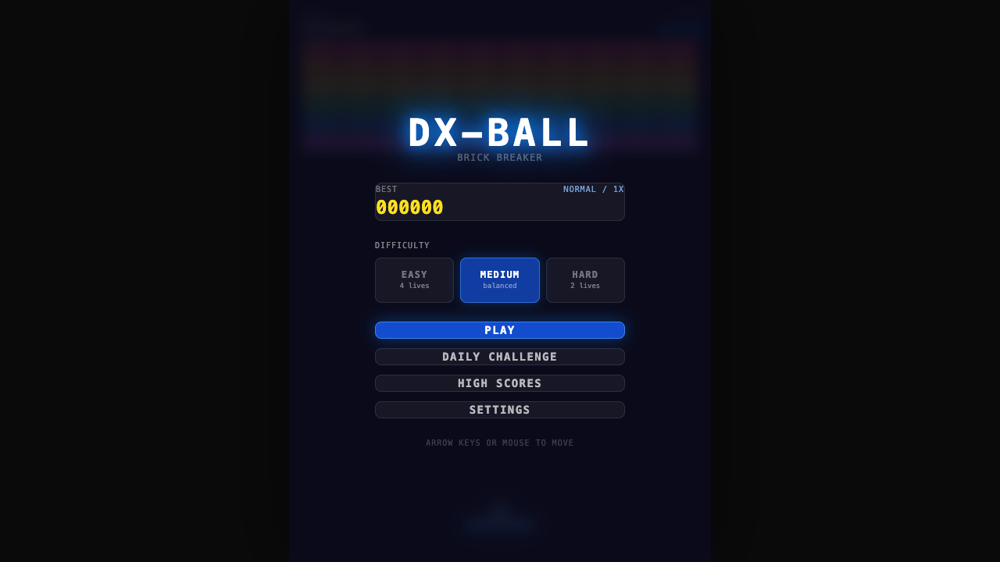
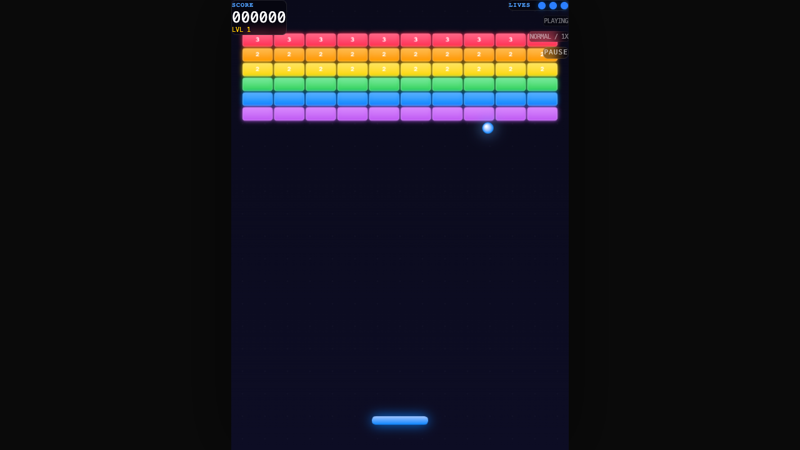

# 🧱 DX-Ball

A fullscreen, neon brick-breaker in the spirit of the classic **DX-Ball** — built from scratch with Next.js, React, and the Canvas 2D API. Procedural audio, power-ups, a named leaderboard, achievements, and a daily challenge. No game assets, no game engine — just math.

### ▶️ [Play it live](https://dx-ball-5luouyi03-zarifs-projects-03f15b7a.vercel.app/)

<p align="center">
  
  
</p>

## Features

- **Fullscreen board** — fixed 480×640 logical resolution, canvas-scaled to the largest 3:4 rect that fits any window, crisp on every display.
- **Pick your difficulty** — Easy / Medium / Hard, chosen on the start screen and in settings (changes lives and brick toughness).
- **Power-ups** — Fireball (burn straight through bricks), Widen, Multiball, Sticky, Laser, Slow, Extra Life.
- **Named leaderboard** — top-10 per mode, saved locally; beat the board and enter your name.
- **Live run stats** — bricks destroyed, best combo, level reached, shown on the end screen.
- **Achievements** — 5 unlockable badges (Combo Master, Flawless, High Roller, Pyromaniac, Daily Grind).
- **Daily challenge** — a deterministic board seeded by the date; same for everyone, every day.
- **Levels & progression** — multiple hand-designed boards with level-up transitions.
- **Feel** — procedural Web Audio SFX, mobile haptics, screen shake, particles, combos, and buttery paddle motion (direct pointer tracking + fixed-timestep physics with render interpolation).

## Controls

| Action | Input |
|--------|-------|
| Move paddle | Mouse / touch, or ← → arrow keys |
| Launch ball / fire laser | Space or Enter |
| Pause | P / Esc (or the on-screen button) |

## Tech

Next.js 16 · React 19 · TypeScript · Canvas 2D · Tailwind CSS v4 · Web Audio API. Fully client-side — scores and achievements live in `localStorage`, no backend.

## Architecture

The game logic is a set of **pure modules** under `src/lib/game/` — the simulation never touches the DOM, which keeps it deterministic and testable:

| File | Responsibility |
|------|----------------|
| `engine.ts` | `updateGame(state, input) → newState` — physics, collisions, power-ups (pure) |
| `renderer.ts` | `drawFrame(ctx, state)` — draws the playfield (no mutation) |
| `constants.ts` / `types.ts` | tunables and shapes |
| `levels.ts` | board layouts as grids |
| `leaderboard.ts` · `achievements.ts` · `daily.ts` | persistence + unlock + daily-seed logic |
| `audio.ts` | procedural SFX via Web Audio |

React (`app/components/DxBallGame.tsx`) owns the canvas, the fixed-timestep loop, input, and the HUD/menu overlays. Each pure module ships a runnable `*.check.ts` self-test.

## Run locally

```bash
npm install
npm run dev     # http://localhost:3000
```

```bash
npm run build && npm start   # production
```
